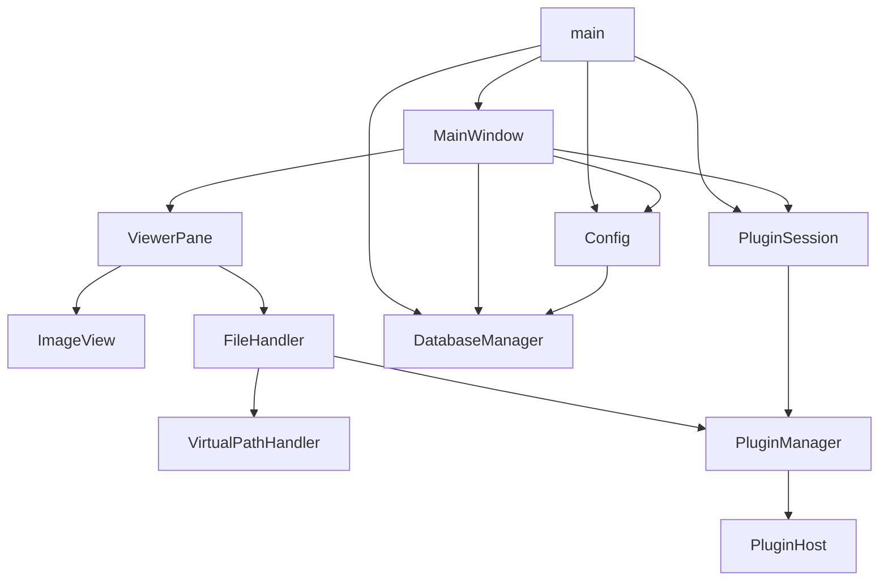
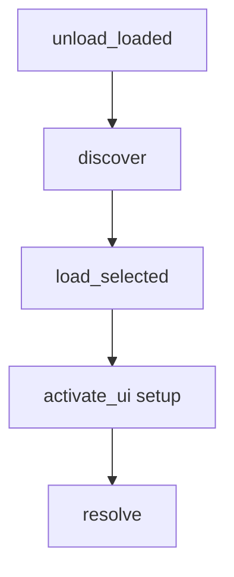

# EzCo アーキテクチャ

初めて読む人が、コードの前に全体を掴む入口です。作者向けのプラグイン契約は [plugins.md](plugins.md)、画像読み込みの詳細は [IMAGE_LOADING.md](IMAGE_LOADING.md)、開発手順の抜けは [DEVELOPMENT.md](DEVELOPMENT.md)、なぜそうしたかは [DECISIONS.md](DECISIONS.md) です。

---

## 製品の主軸

EzCo は Windows 向けのコミックビュワーです。利用者が指した画像・フォルダ・アーカイブを開き、ページを送り、ズームや見開きで見ることに主軸を置きます。

本棚・ライブラリ・ファイル管理 UI は持ちません。履歴とブックマークは「また開く」ためであり、書庫を整理するためではありません。詳細は [DECISIONS.md](DECISIONS.md#viewer-first) です。

---

## 主要ディレクトリ

| パス | 役割 |
| --- | --- |
| `src/ez_co/` | 本体パッケージ。入口は `main.py` |
| `tests/ez_co/` | 本番と同じ階層の pytest。配置ルールは [DEVELOPMENT.md](DEVELOPMENT.md) |
| `plugins/` | 同梱サンプルの展開フォルダ。実行時の掃引先はデータの置き場の `plugins/`（exe 隣ならリポジトリ直下） |
| `dist-sample-plugins/` | 配布用 `.zip` サンプル |
| `resources/` | ユーザーマニュアル、About など。本体 UI 文言は `src/ez_co/resources/langs/` |
| `docs/` | 開発者向け資料 |
| `.cursor/rules/` | Cursor 向けの常時ルール |
| `tooling/` | ビルド・collect・プラグイン ZIP 用 CLI |

---

## 主要コンポーネント

| コンポーネント | パス | 責務 |
| --- | --- | --- |
| `main` | [`src/ez_co/main.py`](../src/ez_co/main.py) | 起動、データの置き場、設定読込、`QApplication` |
| `MainWindow` | [`src/ez_co/ui/main_window.py`](../src/ez_co/ui/main_window.py) | メニュー、タブ、開く／ページ送り、設定ダイアログ、終了時の保存 |
| `ViewerPane` | [`src/ez_co/ui/viewer/viewer_pane.py`](../src/ez_co/ui/viewer/viewer_pane.py) | タブ 1 枚分。`FileHandler` と `ImageView` を持つ |
| `ImageView` | [`src/ez_co/ui/viewer/image_view.py`](../src/ez_co/ui/viewer/image_view.py) | PIL 画像を Qt で表示。ズーム・移動・ジェスチャ |
| `FileHandler` | [`src/ez_co/handlers/file_handler.py`](../src/ez_co/handlers/file_handler.py) | ページ列、キャッシュ、先読み、アーカイブ／プラグイン読込 |
| `VirtualPathHandler` | [`src/ez_co/handlers/virtual_path_handler.py`](../src/ez_co/handlers/virtual_path_handler.py) | `archive://パス\|エントリ` の生成と解析 |
| `Config` | [`src/ez_co/config.py`](../src/ez_co/config.py) | ランタイム設定。永続化は DB |
| `DatabaseManager` | [`src/ez_co/utils/database.py`](../src/ez_co/utils/database.py) | `config.db`。プロファイル設定、プラグイン設定、履歴、ブックマーク |
| `PluginManager` | [`src/ez_co/plugins/manager.py`](../src/ez_co/plugins/manager.py) | `plugins/` の掃引、選択ロード、拡張子解決 |
| `PluginHost` | [`src/ez_co/plugins/host.py`](../src/ez_co/plugins/host.py) | プラグインへ渡す API。`ScopedPluginHost` で隔離 |
| `PluginSession` | [`src/ez_co/ui/plugins/plugin_session.py`](../src/ez_co/ui/plugins/plugin_session.py) | 同意、重複選択、UI 有効化、サイドバーのドック |
| `session_file` | [`src/ez_co/handlers/session_file.py`](../src/ez_co/handlers/session_file.py) | `.ezs` の保存／復元（タブとページ） |

ブックマークは `DatabaseManager` と [`ui/dialogs/bookmark_dialog.py`](../src/ez_co/ui/dialogs/bookmark_dialog.py)、ショートカットは `MainWindow.setup_shortcuts` と [`shortcut_dialog.py`](../src/ez_co/ui/dialogs/shortcut_dialog.py)、ジェスチャは [`gestures/mouse_gesture.py`](../src/ez_co/gestures/mouse_gesture.py) です。描画とページ送りの本体は `ImageView` / `FileHandler` にあり、プラグインには渡しません。

---

## 依存関係

`MainWindow` の `file_handler` / `image_view` は、今のタブの `ViewerPane` へのプロパティです。

---

## 代表フロー

### 通常画像を開く

1. `MainWindow.load_file` / `open_paths` → `FileHandler.open_file` → `open_files`
2. 実 `Path` を `current_files` に載せる
3. `load_current_page` → `update_image` → `FileHandler.get_current_image`（`get_image_at`）
4. `ImageView.set_image`

### アーカイブを開く

1. `open_files` がアーカイブ `Path` を載せ、`_open_current_file` → `_open_archive`
2. プラグイン担当なら `_expand_plugin_archive`、それ以外は `_expand_archive`
3. `current_files` を `archive://アーカイブ|エントリ` の列に置き換える
4. 表示時は `_get_image_from_archive_sync`（現行ページ）または先読みの `_get_image_from_archive`

### ページ送り

`MainWindow.next_page` / `prev_page` → `FileHandler.next_file` / `prev_file`（見開きは `go_to_page`）→ `_move_to_index` → `update_image`。プラグインへは `_notify_plugin_current_changed`。

### プラグイン画像

`PluginManager.resolve` が image なら `_load_plugin_image`（`read_entry(path, 0)`）。archive なら `list_entries` で仮想パス列を作り、表示時に `_read_plugin_archive_entry`。

### 設定変更

`SettingsDialog` → `MainWindow.save_config` → `DatabaseManager.save_profile_config`。反映は `apply_loaded_profile_config`。プラグイン設定は `PluginSession.after_config_change`（必要なら `reload_selected` と開いているファイルの再読込）。

### 終了時

`MainWindow.closeEvent` が履歴とウィンドウ位置と `save_config` を書く。プロセス終了時に `PluginManager.unload_loaded` は呼ばれません。`unload_loaded` は再 discover や明示 teardown 用です。

---

## 本体側のプラグイン寿命

作者向けの manifest / `FileLoader` / host API は [plugins.md](plugins.md) です。ここでは本体がいつ何をするかだけ書きます。

1. `PluginManager.discover` が `plugins_dir()`（`get_data_root() / "plugins"`）を掃引する
2. バックエンドは [`backends.py`](../src/ez_co/plugins/backends.py):
   - `ZipPythonBackend`: `.zip` または `manifest.json` 付きフォルダ
   - `DllBackend`: `.dll` を認識するが `load` は常に `None`（未対応。警告ログ）
3. peek で `candidates` を作る。例外は `failed` に残し、本体は落とさない
4. `load_selected` が `plugins.source_choice` で重複 id を 1 本選ぶ。未選択は `skipped`
5. `PluginSession.bootstrap` のあと `activate_ui` が `setup()` を呼ぶ。例外は `plugin.error` を立て、`enabled_plugins` から外す。`plugins.enabled` を自動で False にはしない
6. 開くファイルは `resolve` / `resolve_extension`。`plugins.extension_handlers` と旧 `archive.*` を見る
7. 新しい ZIP／フォルダの追加・削除は再起動が要る。ON/OFF と担当の付け替えは設定の OK / 適用で足りる

**なぜ（短く）:** プラグインはコールバック側です。`import ez_co` を禁じるのは結合事故防止であり、サンドボックスではありません。提供物（`formats` / `sidebar`）と権限（`permissions`）は manifest が正で、本体が実行前に読みます。詳細は [DECISIONS.md](DECISIONS.md) です。

---

## データの置き場

プロファイル横断の場所は [`data_location.py`](../src/ez_co/utils/data_location.py) です。`user.json` の `data_location` が `user` / `exe` / `custom` です。

| もの | 場所 |
| --- | --- |
| データルート | `get_data_root()`。未設定時は `%APPDATA%/EzCo` |
| `config.db` | データルート直下 |
| プラグイン | データルートの `plugins/` |
| ログ | データルートの `logs/`（デバッグ時） |
| 同意バージョン | `%APPDATA%/EzCo/user.json`（場所設定と同居） |

`exe` を選ぶとルートは `get_project_root()` なので、開発中はリポジトリの `plugins/` がそのまま読めます。

---

## 変更時の注意

- `FileHandler` を触るときは cache / prefetch / session を一緒に見る。[IMAGE_LOADING.md](IMAGE_LOADING.md)
- プラグイン契約を変えるときは [plugins.md](plugins.md) とユーザーマニュアル。権限や提供物は manifest 側
- `MainWindow` 全体や描画の自動テストは書かない
- 理由がコードに無いことは、ここでも断定しません
