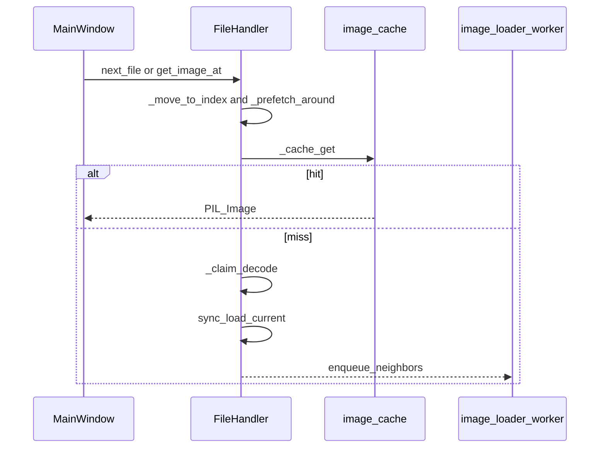

# 画像読み込み

[`FileHandler`](../src/ez_co/handlers/file_handler.py) 周辺の現行実装です。全体の位置づけは [ARCHITECTURE.md](ARCHITECTURE.md)、判断の理由は [DECISIONS.md](DECISIONS.md) です。

---

## 読み込み経路

入口は `open_file` → `open_files` です。先頭で `stop_all_loading()` し、`current_files` を作り直します。

| 対象 | `current_files` の中身 | 画像の取り方 |
| --- | --- | --- |
| 通常画像 | 実 `Path` | `Image.open` → `image.load()` |
| フォルダ | `_scan_directory`。中のアーカイブは展開して混ぜる | 各要素の経路に従う |
| ZIP / RAR / 7z / TAR / 単体圧縮 / PDF | `archive://アーカイブ\|エントリ` | `_get_image_from_archive_sync`（現行）または `_get_image_from_archive`（先読み） |
| プラグイン画像 | 実 `Path` | `_load_plugin_image` → `read_entry(path, 0)` |
| プラグインアーカイブ | `list_entries` の全名前を仮想パスに（画像拡張子で切らない） | `_read_plugin_archive_entry` |

ビルトインのアーカイブ展開（`_expand_archive`）は画像拡張子だけを仮想エントリにします。PDF は [`pdf_handler.py`](../src/ez_co/handlers/pdf_handler.py) が `page_XXXX.png` または埋め込み画像名を返します。

ページ移動は `next_file` / `prev_file` / `go_to_page` が `_move_to_index` を呼び、成功したら `_prefetch_around` します。



---

## VirtualPath

形式は `archive://アーカイブパス|エントリ名` と、判定用の `archive:\…|…` だけです。[`VirtualPathHandler`](../src/ez_co/handlers/virtual_path_handler.py) が `is_virtual_path` / `parse_virtual_path` / `create_virtual_path` を持ちます。`FileHandler` も同じ f-string を直接作ります。

`parse_virtual_path` は先頭 9 文字を除き、`|` で分割して `(Path(archive), filename)` を返します。他のスキームはありません。

---

## キャッシュ

| 項目 | 現行 |
| --- | --- |
| 本体 | `image_cache`: `dict[str, PIL.Image]` |
| キー | `_cache_key_for_file`。実ファイルは `Path.resolve()`。仮想パスは `resolved_archive\|filename`（`archive://` は含めない） |
| 上限 | `cache.memory_limit`（既定 `"256MB"`） |
| 追い出し | 上限超過時、現在ページから遠いキーから削除。現在と前後 1 ページはピン |
| ロック | `_cache_lock`（`RLock`） |
| クリア | `stop_all_loading` の `_clear_image_cache` のみ。`close()` は画像キャッシュを触らない |

同期 `get_image_at` は、推定サイズが上限を超えても画像は返し、キャッシュには入れません。先読み `_load_image` は超過時に `image.close()` して捨てます。

### 表示フィルター

Decode 後の原画は `image_cache` のままです。表示時だけ [`MainWindow._get_display_image`](../src/ez_co/ui/main_window.py) が [`apply_pipe`](../src/ez_co/filters/pipeline.py) します。見開きは各ページに pipe してから `combine_spread_images` します。原画キャッシュは加工画像で上書きしません。先読みワーカーは原画のみです。空 pipe、または台帳に載るのが `builtin:basic` の identity だけなら同一オブジェクトです（copy / `process` なし）。プラグインへは working copy を渡します。サムネイル／画像リストは原画のままです。回転・ズームは `ImageView` の QImage 側です。


### アーカイブ metadata

`archive_metadata_cache` のキーは解決済みアーカイブパスです。値は `fingerprint = (st_mtime_ns, st_size)` とエントリ一覧です。fingerprint が一致すれば ZIP / RAR / 7z / TAR の同期読込で namelist を省略します。

有効条件は `debug.cache_archive_metadata`（既定 `True`）。`stop_all_loading` と `close()` で消します。

**なぜ:** ページごとに namelist していたのを避けるためです。フォルダの「次ファイル再計算」とは別で、ZIP はスナップショットのままです。[DECISIONS.md](DECISIONS.md#zip-snapshot)

---

## 先読み

`_prefetch_around(index)` が、`cache.prefetch_pages` の窓で隣を `_image_queue` に積みます。設定の既定は **15** です。`config` が無いときのフォールバックは **3** です。

優先は次ページが 1、その先の次が 2 以降、前ページは `n+i` で後ろです。

`_move_to_index` が `next_file` / `prev_file` / `go_to_page` から呼ばれ、開いたあと `_prefetch_around` します。

`_image_queue` が実働です。積むのは `is_current=False` の先読みだけです。現行ページをキューに載せる呼び出しはありません。

`_prefetch_queue` は、ワーカーが `get` して `_prefetch_around` するループと、`__del__` の停止シグナル以外に `put` がありません。`PriorityQueue` の import はありますが、先読みの優先は `_prefetch_around` 内のタプル順です。

**なぜ:** 連写 ZIP で窓がページに追従していなかったので、移動後に `_prefetch_around` を呼ぶようにしました。PriorityQueue 化は、現行ページがまだ GUI 同期なので体感の本命ではありません。予定としては書きません。[DECISIONS.md](DECISIONS.md#prefetch-follow)

---

## 重複 decode

| メソッド | 動作 |
| --- | --- |
| `_claim_decode` | `"have"` / `"wait"` / `"owner"` |
| `_wait_for_decode` | `Event.wait(_load_wait_timeout)`。タイムアウトは **0.4 秒** |
| `_finish_decode` | in-progress を外し Event をセット |

同期 `get_image_at` と先読み `_load_image` の両方が使います。

**なぜ:** キャッシュ miss の同期 load と worker が同じキーを二重に開いていたためです。

---

## セッション

`_current_session_id` は `stop_all_loading` の中だけで増えます。`open_files` の先頭がこれを呼びます。

`stop_all_loading` は停止フラグを立て、session を進め、両キューを空にし、prefetch 状態と decode Event、`archive_metadata_cache`、画像キャッシュを捨ててからフラグを戻します。新しい session_id を返します。

`_is_session_active` は「id が今と同じ、かつ停止フラグが立っていない」です。先読みと非同期アーカイブ読込はここで古い結果を捨てます。

同期 `get_image_at` の仮想パス読込（`_get_image_from_archive_sync`）は、コメントどおりセッションチェックをスキップします。

切り替えの流れ:

```text
アーカイブ A を開く
→ 先読みが pending
→ アーカイブ B を開く（open_files → stop_all_loading）
→ session_id が進み、A 用のキューと cache は空
→ worker は古い session_id を捨てる
```

---

## スレッド

| どこ | 何をする |
| --- | --- |
| GUI（呼び出しスレッド） | `get_image_at` の同期 decode、`ImageView.set_image` |
| `image_loader_worker` | `_image_queue` から先読みを `_load_image` |
| `prefetch_worker` | `_prefetch_queue` を待つ。現行は停止用以外ほぼ仕事が無い |

`_schedule_on_main_thread` は `QTimer.singleShot(0, …)` です。先読み完了で `set_image` しません。通知は `is_current` のときだけです（キューに `is_current=True` を積む経路は今ありません）。

`ThreadPoolExecutor(max_workers=3)` は生成と `__del__` の shutdown だけで、`submit` はありません。

worker から `QWidget` は触りません。

---

## アーカイブハンドル

`debug.keep_archive_handles`（既定 `False`）が True のときだけ、ZIP / TAR などでハンドルを保持します。7z / RAR はコメントどおり都度開閉で、ここでも保持しません。

フォルダ走査は、保持するなら `Path.rglob`、しないなら `os.walk`（コメント: ディレクトリハンドルをすぐ離す）です。

長時間持たないことの製品上の理由は、コードから断定できません。コメントは「新しい方式」「都度開閉」と書いています。

---

## 性能上の注意（実装から言える範囲）

- 現行ページは GUI 同期 load のままです。体感の待ちはここが支配しやすいです
- metadata cache が効いていると、同じアーカイブの namelist 再走査を避けます
- 先読みは FIFO の `_image_queue` です。優先はエンキュー順で付けています
- プラグイン画像は `read_entry` のコストがそのまま乗ります
- 未計測のミリ秒は書きません
