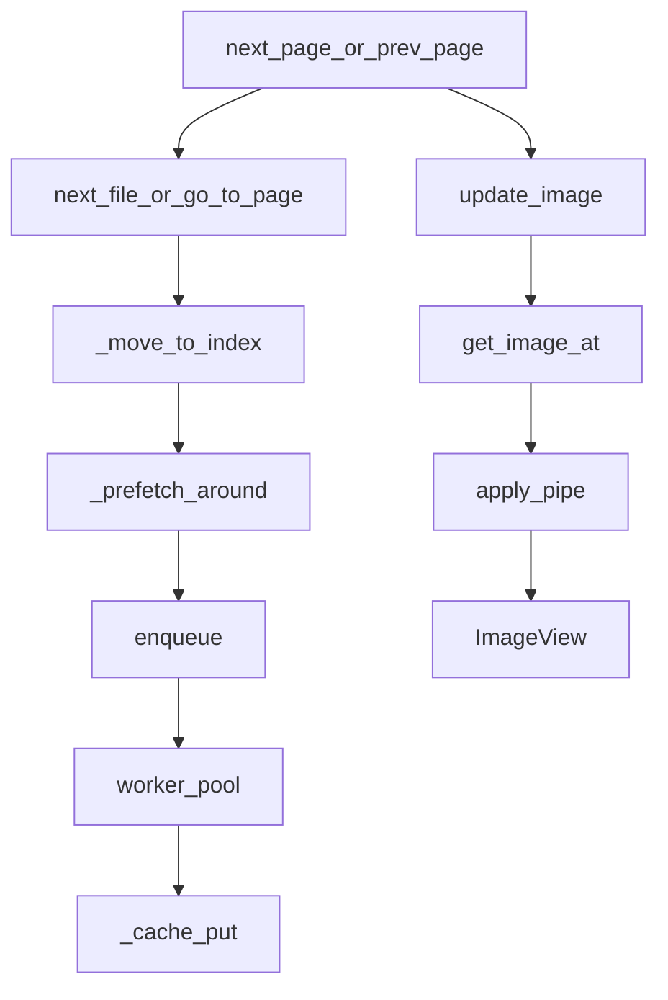
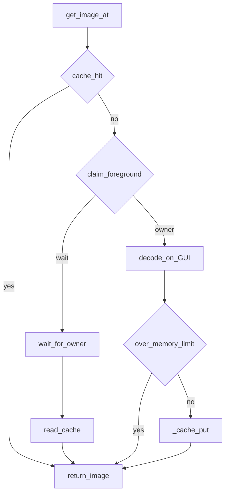
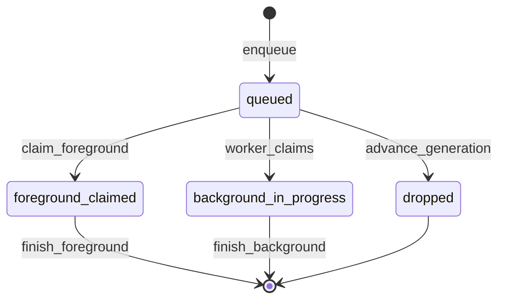
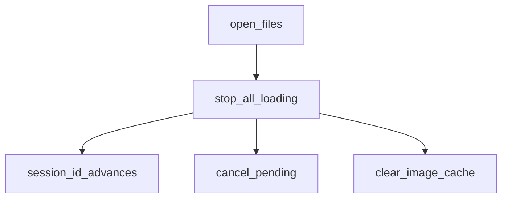

# 画像読み込み

[`FileHandler`](../src/ez_co/handlers/file_handler.py) 周辺の現行実装です。全体の位置づけは [ARCHITECTURE.md](ARCHITECTURE.md)、判断の理由は [DECISIONS.md](DECISIONS.md) です。

---

## いまのフロー

同期読み込みと先読みは別の流れです。ページ移動は両方を始めますが、一本にはつながりません。出会うのは `image_cache` と、先読みがすでに decode しているときの `claim_foreground` だけです。

### ページ移動

`MainWindow.next_page` / `prev_page` は、先に `next_file` / `prev_file` / `go_to_page` を呼び、移動できたあとで `update_image` を呼びます。ファイルを開いたときも、`open_files` が先読みを始め、表示はあとから `get_image_at` です。



左の枝が先読みです。`_prefetch_around` は現在ページを積まず、隣から `ImageLoadScheduler` の worker が decode して cache に置きます。右の枝が同期読み込みです。GUI が `get_image_at` で現在ページを取り、`apply_pipe` してから `ImageView` に出します。先読みの完了では `set_image` しません。

先読みの優先は、最後の改ページ方向の近いページ、その反対、遠いページです。優先の数は近いほど小さく、queue は `(priority, sequence, task)` です。worker は `FileHandler` ごとで、本数は起動時に確定した `cache.image_loader_workers` です。

### 同期読み込み

`get_image_at` だけです。先読みの enqueue はこの中にありません。



`owner` は GUI がその場で decode します。推定サイズが `cache.memory_limit` を超える画像は返しますが、cache には入れません。`wait` は、同じ cache key が `background_in_progress` か `foreground_claimed` のときです。完了を待って cache から受け取り、自分では decode しません。

### 先読みの状態

worker が持つ状態です。同期読み込みが自分で decode するときは `foreground_claimed` になり、worker はその key を取りません。



ページ移動の `_prefetch_around` は、積む前に `advance_generation` します。未開始の `queued` は捨てます。すでに `background_in_progress` の decode は完了まで続けます。同じ cache key を新しい優先度で積み直すと token が進み、queue に残った古い item は開始前に無効です。先読みが上限を超える画像は `image.close()` して捨て、画面には返しません。

### 別ファイルを開く

新しいファイルの同期読み込みでも先読みでもありません。前の読み込みを止める処理です。



`open_files` の先頭が `stop_all_loading` です。session を進め、scheduler の未開始と待ちを外し、画像 cache を空にします。そのあとで新しいページ列を作り、先読みと、UI からの同期読み込みがそれぞれ始まります。

---

## 読み込み経路

入口は `open_file` → `open_files` です。先頭で `stop_all_loading()` し、`current_files` を作り直します。

| 対象 | `current_files` の中身 | 画像の取り方 |
| --- | --- | --- |
| 通常画像 | 実 `Path` | `Image.open` → `image.load()` |
| フォルダ | `_scan_directory`。中のアーカイブは展開して混ぜる | 各要素の経路に従う |
| ZIP / RAR / 7z / TAR / 単体圧縮 / PDF | `archive://アーカイブ\|エントリ` | `_get_image_from_archive_sync`（現行）または `_get_image_from_archive`（先読み） |
| プラグイン画像 | 実 `Path` | `_load_plugin_image` → `read_entry(path, 0)` |
| プラグインアーカイブ | `list_entries` の全名前を仮想パスに（画像拡張子で切らない） | `_read_plugin_archive_entry` |

ビルトインのアーカイブ展開（`_expand_archive`）は画像拡張子だけを仮想エントリにします。PDF は [`pdf_handler.py`](../src/ez_co/handlers/pdf_handler.py) が `page_XXXX.png` または埋め込み画像名を返します。

ページ移動は `next_file` / `prev_file` / `go_to_page` が `_move_to_index` を呼び、成功したら `_prefetch_around` します。表示の同期読み込みは、そのあと UI が `get_image_at` を呼びます。二つの流れは [いまのフロー](#いまのフロー) です。

---

## VirtualPath

形式は `archive://アーカイブパス|エントリ名` と、判定用の `archive:\…|…` だけです。[`VirtualPathHandler`](../src/ez_co/handlers/virtual_path_handler.py) が `is_virtual_path` / `parse_virtual_path` / `create_virtual_path` を持ちます。`FileHandler` も同じ f-string を直接作ります。

`parse_virtual_path` は先頭 9 文字を除き、`|` で分割して `(Path(archive), filename)` を返します。他のスキームはありません。

---

## キャッシュ

| 項目 | 現行 |
| --- | --- |
| 本体 | `image_cache`: `dict[str, PIL.Image]` |
| キー | `_cache_key_for_file`。実ファイルは `Path.resolve()`。仮想パスは `resolved_archive\|filename`（`archive://` は含めない） |
| 上限 | `cache.memory_limit`（既定 `"256MB"`） |
| 追い出し | 上限超過時、現在ページから遠いキーから削除。現在と前後 1 ページはピン |
| ロック | `_cache_lock`（`RLock`） |
| クリア | `_clear_image_cache` のみ。呼ぶのは `stop_all_loading` で、`close()` もその `stop_all_loading` 経由で消す |

同期 `get_image_at` は、推定サイズが上限を超えても画像は返し、キャッシュには入れません。先読み `_load_image` は超過時に `image.close()` して捨てます。

### 表示フィルター

Decode 後の原画は `image_cache` のままです。表示時だけ [`MainWindow._get_display_image`](../src/ez_co/ui/main_window.py) が [`apply_pipe`](../src/ez_co/filters/pipeline.py) します。見開きは各ページに pipe してから `combine_spread_images` します。原画キャッシュは加工画像で上書きしません。先読みワーカーは原画を cache に置くところまでで、pipe や `ImageView` には続きません。空 pipe、または台帳に載るのが `builtin:basic` の identity だけなら同一オブジェクトです（copy / `process` なし）。プラグインへは working copy を渡します。サムネイル／画像リストは原画のままです。回転・ズームは `ImageView` の QImage 側です。


### アーカイブ metadata

`archive_metadata_cache` のキーは解決済みアーカイブパスです。値は `fingerprint = (st_mtime_ns, st_size)` とエントリ一覧です。fingerprint が一致すれば ZIP / RAR / 7z / TAR の同期読込で namelist を省略します。

有効条件は `debug.cache_archive_metadata`（既定 `True`）。`stop_all_loading` と `close()` で消します。

**なぜ:** ページごとに namelist していたのを避けるためです。フォルダの「次ファイル再計算」とは別で、ZIP はスナップショットのままです。[DECISIONS.md](DECISIONS.md#zip-snapshot)

---

## 先読み

`_prefetch_around(index)` が、`cache.prefetch_pages` の窓で隣を `ImageLoadScheduler` に積みます。設定の既定は **5** です。`config` が無いときのフォールバックは **3** です。

実働は共通 `PriorityQueue` と設定された本数のworkerです。`cache.image_loader_workers` は `"auto"` または1～8で、autoは論理CPU数から1～6本を選びます。起動プロファイルとruntime overrideの適用後にeffective値を一度だけ確定し、同じprocessでは設定保存やプロファイル切替後も変えません。最後の改ページ方向を優先側とし、優先側の近いページ、その反対側、遠いページの順で処理します。queue itemは `(priority, sequence_number, task)` で、同順位は投入順です。

`_move_to_index` が `next_file` / `prev_file` / `go_to_page` から呼ばれ、開いたあと `_prefetch_around` します。

ページ移動ごとにgenerationを進めます。未開始の旧generationはqueueから除去し、workerがすでに取得していた旧taskも開始前検証で捨てます。開始済みdecodeは完了まで続けます。同じcache keyを新しい優先度で要求するとtaskごとの単調増加tokenが更新され、古いqueue itemは無効になります。

旧 `_image_queue`、`_prefetch_queue`、`prefetch_worker`、未使用 `ThreadPoolExecutor` はありません。schedulerがworker lifecycle、queued/in-progress、generation、token、shutdownを所有します。

**なぜ:** 窓の追従だけではFIFOの古い仕事を捨てられず、単一workerが現在位置へ追いつけませんでした。priority、世代破棄、worker poolを一体で扱います。[DECISIONS.md](DECISIONS.md#prefetch-follow)

---

## 重複 decode

| メソッド | 動作 |
| --- | --- |
| scheduler `enqueue` | prefetchをqueuedとして登録 |
| scheduler `claim_foreground` | 未開始ならforegroundへ所有権を移し、実行中なら`Event`を返す |
| scheduler完了処理 | 状態を外し、成功・失敗とも`Event`をセット |

同期 `get_image_at` と先読みworkerの両方が同じscheduler状態を使います。未開始prefetchへforegroundが追いつけばforegroundが1回だけdecodeします。backgroundで開始済みならGUIは同じ完了を待ち、結果をcacheから受け取ります。旧0.4秒timeout後のduplicate decodeはしません。

**なぜ:** キャッシュ miss の同期 load と worker が同じキーを二重に開いていたためです。

---

## セッション

`_current_session_id` は `stop_all_loading` の中だけで増えます。`open_files` の先頭がこれを呼びます。

`stop_all_loading` は停止フラグを立て、session を進め、schedulerの未開始taskと待機event、`archive_metadata_cache`、画像キャッシュを捨ててからフラグを戻します。新しい session_id を返します。

`_is_session_active` は「id が今と同じ、かつ停止フラグが立っていない」です。先読みと非同期アーカイブ読込はここで古い結果を捨てます。

同期 `get_image_at` の仮想パス読込（`_get_image_from_archive_sync`）は、コメントどおりセッションチェックをスキップします。

切り替えの流れ:

```text
アーカイブ A を開く
→ 先読みが pending
→ アーカイブ B を開く（open_files → stop_all_loading）
→ session_id が進み、A 用のキューと cache は空
→ worker は古い session_id を捨てる
```

---

## スレッド

| どこ | 何をする |
| --- | --- |
| GUI（呼び出しスレッド） | `get_image_at` の同期 decode、`ImageView.set_image` |
| `ImageLoadScheduler` worker | process起動時に確定した本数で、共通PriorityQueueから先読みをdecode |

`_schedule_on_main_thread` は `QTimer.singleShot(0, …)` です。先読み完了で `set_image` しません。現在ページのcache missは引き続きGUI同期です。

同一Plugin instanceの `list_entries` / `read_entry` は、foregroundとbackgroundのどちらからでも同じPlugin lockを通ります。archive metadataの構築は同一sourceだけ共有し、異なるarchiveをglobal lockで直列化しません。

worker から `QWidget` は触りません。worker poolは `FileHandler` ごとなので、複数の閲覧タブでFileHandlerが生存すれば合計thread数も増えます。

---

## アーカイブハンドル

`debug.keep_archive_handles`（既定 `False`）が True のときだけ、ZIP / TAR などでハンドルを保持します。7z / RAR はコメントどおり都度開閉で、ここでも保持しません。

フォルダ走査は、保持するなら `Path.rglob`、しないなら `os.walk`（コメント: ディレクトリハンドルをすぐ離す）です。

長時間持たないことの製品上の理由は、コードから断定できません。コメントは「新しい方式」「都度開閉」と書いています。

---

## 性能上の注意（実装から言える範囲）

- 現行ページは GUI 同期 load のままです。backgroundで同じページをdecode中なら、その完了待ちもGUI上です
- metadata cache が効いていると、同じアーカイブの namelist 再走査を避けます
- 先読みは起動時に確定したworker数のPriorityQueueです。旧generationの未開始taskはqueueから除去します
- プラグイン画像は `read_entry` のコストがそのまま乗ります
- 未計測のミリ秒は書きません

`debug.enabled=true` のときは、cache hit/miss、queue待ち、source read/decode、最適化、cache put、全体時間、queue深度、active worker、stale破棄、未使用prefetch追放をdebugログへ記録します。filter、見開き合成、RGBA変換は表示準備として別に記録します。通常利用では詳細計測用のtimestampと文字列組み立てを行いません。

### 性能比較の手順

`poetry run python -m tooling.image_loader_benchmark --output tooling/logs/image_loader_benchmark.json` は固定seedで (A) JPGだけのフォルダ、(B) JPG/PNGを含むZIP、(C) 高解像度画像を含むZIPを生成します。worker 1～8の実行順を固定seedでshuffleし、各条件をwarmup 1回・測定5回、runごとに新しいFileHandler / Scheduler / cacheで測ります。OS file cacheは制御しません。

100ページ遷移を集約した平均 / p50 / p95 / max、cache hit/miss、decode throughput、重複decode、未使用prefetch追放、cache peak、取得可能な環境でのprocess CPU / RSSを比較します。RSSを標準ライブラリで取得できない環境ではN/Aです。合否は固定ミリ秒ではなく、worker増加がp95を改善するか、過剰workerで劣化やcache churnが増えないかを確認します。単一端末の結果から全CPU帯のauto表は変更しません。

### 2026-09-21 の生成素材benchmark

24論理CPU、`memory_limit=256MB`、`prefetch_pages=15`、画像最適化OFFで測定しました。各値は20ページ×5runです。

| 素材 | 主な結果 |
| --- | --- |
| JPGフォルダ | worker 1のp95 9.28ms・cache hit 40/100に対し、2はp95 8.24ms・95/100。2～8は全条件95/100で、p95は8.24～12.13ms |
| JPG/PNG ZIP | worker 1のp95 17.11ms・cache hit 10/100。2は10.40ms・95/100。2～8は全条件95/100で、p95は10.40～16.51ms |
| 高解像度ZIP | worker 1のp95 34.27ms、2は44.07ms、3は130.12ms、4は61.76ms、6は364.46ms、8は448.53ms。未使用prefetch追放/再decodeは1本の20件、2本の22件から8本の211件まで増加 |

全条件でScheduler所有権による同時duplicate decodeは再現しませんでした。高解像度条件の `redecode_count` は、256MB cacheからprefetch済み画像が追放されたあと再度必要になったcache churnです。process CPUとRSSを取得でき、通常素材のRSSは約200～201MB、高解像度素材は約386～388MBでした。

この結果はworker設定の価値と、worker数だけを増やしてもcache容量との不均衡で悪化することを示します。ただし1台だけの結果なのでautoのCPU帯表は変更しません。24論理CPUで高解像度ZIPを多用する場合は手動1～2本、またはcache容量の増加を比較対象にします。

### worker × cache容量 benchmark

前の結果が「worker過多」そのものか、「workerが短時間にdecodeした画像を256MB cacheが保持できず、到達前に追放する」ことが主因かを切り分けました。高解像度ZIP、24論理CPU、`prefetch_pages=15`、20ページ、warmup 1回、測定5回です。worker 1～8 × cache 256MB / 512MB / 1GBの24条件を固定seedでshuffleし、各条件を独立processで実行しました。OS file cacheは制御していません。

生成した20ページのdecoded working setは合計460.8MB、平均・最大とも1ページ23.04MBです。表の未使用追放MBは5runの合計、RSSは各condition processのpeakです。

| Cache | Worker | p95 ms | Hit率 | Redecode | 未使用追放 | 未使用追放MB | RSS peak MB |
| --- | ---: | ---: | ---: | ---: | ---: | ---: | ---: |
| 256MB | 1 | 104.67 | 5% | 20 | 20 | 460.8 | 413.0 |
| 256MB | 2 | 106.83 | 51% | 20 | 20 | 460.8 | 444.6 |
| 256MB | 3 | 139.38 | 72% | 28 | 28 | 645.1 | 475.2 |
| 256MB | 4 | 237.68 | 94% | 40 | 40 | 921.6 | 506.2 |
| 256MB | 5 | 305.31 | 91% | 84 | 84 | 1935.4 | 537.1 |
| 256MB | 6 | 331.10 | 93% | 121 | 121 | 2787.8 | 567.7 |
| 256MB | 7 | 405.77 | 94% | 157 | 157 | 3617.3 | 599.4 |
| 256MB | 8 | 447.13 | 94% | 203 | 203 | 4677.1 | 630.6 |
| 512MB | 1 | 41.24 | 5% | 0 | 0 | 0 | 659.2 |
| 512MB | 2 | 25.78 | 35% | 0 | 0 | 0 | 659.6 |
| 512MB | 3 | 16.85 | 66% | 0 | 0 | 0 | 659.8 |
| 512MB | 4 | 16.51 | 95% | 0 | 0 | 0 | 660.5 |
| 512MB | 5 | 19.17 | 95% | 0 | 0 | 0 | 660.4 |
| 512MB | 6 | 21.91 | 95% | 0 | 0 | 0 | 660.0 |
| 512MB | 7 | 18.36 | 95% | 0 | 0 | 0 | 660.9 |
| 512MB | 8 | 17.21 | 95% | 0 | 0 | 0 | 660.9 |
| 1GB | 1 | 38.32 | 5% | 0 | 0 | 0 | 659.0 |
| 1GB | 2 | 26.23 | 49% | 0 | 0 | 0 | 659.4 |
| 1GB | 3 | 16.23 | 68% | 0 | 0 | 0 | 659.9 |
| 1GB | 4 | 16.06 | 95% | 0 | 0 | 0 | 660.3 |
| 1GB | 5 | 18.54 | 95% | 0 | 0 | 0 | 660.2 |
| 1GB | 6 | 20.35 | 95% | 0 | 0 | 0 | 660.2 |
| 1GB | 7 | 17.02 | 95% | 0 | 0 | 0 | 660.9 |
| 1GB | 8 | 17.03 | 95% | 0 | 0 | 0 | 660.8 |

`duplicate_decode_count` は全24条件で0でした。これはScheduler所有権違反による同時二重decodeがないことを表します。`redecode_count` はcache追放後に同じページが再び必要になった正常な再decodeで、256MBだけに発生しました。condition開始から終了までのRSS増分は約1.1～2.6MBでしたが、peak RSSはdecoded画像を保持できる512MB以上で約659～661MBです。

判定はケースAとCです。256MBではworker増加に伴うcache churnが主因となってp95が悪化しました。512MBでは未使用追放と再decodeが全条件で0になり、worker 3～8のp95は16.51～21.91msまで改善しました。1GBは16.06～20.35msで512MBからほぼ改善せず、この生成素材では512MB付近がworking setを保持できるsweet spotです。十分なcacheでもworker 5～6は4より速くならず、worker増加の効果は頭打ちです。

これは1台・1種類の生成素材による切り分け結果です。`cache.image_loader_workers` のauto表、`memory_limit=256MB`の既定値、`prefetch_pages=15`はこの作業では変更しません。本番設定の見直しは通常素材へのRSS影響も含む別Planで判断します。

### 2026-09-21 性能一括計測

Windows 11、Python 3.12.5、Pillow 11.2.1、Qt 6.9.1、24論理CPUで、全条件を独立processとして測りました。loader条件は固定seed、warmup 1回、測定5回です。一次データは `tooling/logs/image_performance_batch.json`、短い一覧は `tooling/logs/image_performance_batch.md` です。queue p95はwall-clockで重み付けした時間分布ではなく、enqueue、claim、worker開始・完了、stale破棄、generation cleanupという**状態変化event sample**の分布です。

#### cache default candidate

worker 4、prefetch 15、20ページでcache 256MBと512MBを比較しました。

| 素材 | 256MB p95 / RSS peak | 512MB p95 / RSS peak | 256MB → 512MBのchurn |
| --- | --- | --- | --- |
| JPGフォルダ | 10.80ms / 199.3MB | 11.06ms / 199.5MB | 0 → 0 |
| JPG/PNG ZIP | 14.21ms / 199.8MB | 15.20ms / 199.5MB | 0 → 0 |
| 高解像度ZIP | 244.63ms / 507.3MB | 17.85ms / 661.2MB | 未使用追放・再decode 58回 → 0回 |

通常素材ではcache peakが115.2MBに収まり、512MB化によるRSS増加も改善もありませんでした。高解像度20ページのdecoded working setは460.8MBで、256MBでは5run合計1.336GBを到達前に追放し、512MBでは保持できました。したがって512MBは高解像度churnを解消する有力候補です。ただし後述の複数タブではhandlerごとの上限が加算されるため、**process-wide budgetなしに512MBを既定化する判断はしません**。

#### prefetch window

worker 4、cache 512MB、64ページsourceの先頭20ページを測り、source全体の先読みはしていません。

| 素材 | prefetch | 平均 / p95 / max | Hit率 | queue max / event p95 | churn | RSS peak |
| --- | ---: | --- | ---: | --- | ---: | ---: |
| JPG/PNG ZIP | 5 | 6.07 / 9.63 / 13.81ms | 95% | 1 / 1 | 0 | 238.5MB |
| JPG/PNG ZIP | 10 | 8.44 / 11.88 / 12.74ms | 95% | 6 / 4 | 0 | 277.4MB |
| JPG/PNG ZIP | 15 | 10.92 / 15.09 / 20.15ms | 95% | 11 / 8 | 0 | 315.6MB |
| JPG/PNG ZIP | 20 | 12.90 / 17.52 / 24.36ms | 95% | 16 / 13 | 0 | 354.2MB |
| 高解像度ZIP | 5 | 8.40 / 15.57 / 41.60ms | 65% | 2 / 2 | 0 | 814.8MB |
| 高解像度ZIP | 10 | 31.98 / 36.12 / 614.11ms | 95% | 6 / 5 | 0 | 846.1MB |
| 高解像度ZIP | 15 | 90.56 / 731.84 / 822.63ms | 95% | 11 / 9 | 43回 | 845.9MB |
| 高解像度ZIP | 20 | 121.83 / 768.88 / 949.57ms | 95% | 16 / 13 | 104回 | 846.0MB |

この生成素材ではprefetch 5が両素材で最小の平均・p95・RSSでした。高解像度のHit率は65%まで下がりましたが、stall分布も10以上より良好です。10はchurnなしでHit率95%を保つ保守的候補、15以上は512MBでも窓がworking setを超えてchurnしました。既定変更は実装せず、次の候補は**latency優先なら5、Hit率優先なら10**とします。

#### foreground stall

cold jumpは各sample直前にcache missかつScheduler未登録を確認しました。collisionはbackground decode開始を止め、foregroundがwaitをclaimしてから解放しました。

| Scenario | 素材 | sample | 平均 / p95 / max | claim / decode | 結果 |
| --- | --- | ---: | --- | --- | --- |
| cold jump | JPG/PNG ZIP | 30 | 12.12 / 14.82 / 16.98ms | owner 30 / sync decode 30 | cold条件を全件確認 |
| cold jump | 高解像度ZIP | 30 | 34.38 / 40.38 / 42.21ms | owner 30 / sync decode 30 | cold条件を全件確認 |
| in-progress collision | 高解像度ZIP | 5 | 31.89 / 34.58 / 34.66ms | wait 5 / sync decode 0 | completion再利用 5、duplicate 0 |

Schedulerの所有権は二重decodeを防いでいますが、cache missの同期decodeとbackground完了待ちは現在もGUI threadを止めます。ゼロstallを目指すならcurrent pageの完全非同期化が必要です。

#### display preparation

2400×3200画像をcache hit相当で渡し、GUI main thread上の`apply_pipe`、見開き合成、`ImageView.set_image`を測りました。各値は5回の平均です。

| Mode | Filter | Spread compose | RGBA変換 | set_imageのその他 | Total |
| --- | ---: | ---: | ---: | ---: | ---: |
| filter OFF | 0.01ms | 0ms | 10.27ms | 44.08ms | 54.36ms |
| builtin basic | 78.96ms | 0ms | 10.69ms | 45.72ms | 135.36ms |
| 見開き | 153.73ms | 91.56ms | 17.20ms | 90.99ms | 353.48ms |

これはQt paint eventやcompositorのframe latencyを含みません。cache hit後にもfilter OFFで約54msあり、basic filterと見開きではdecode以外の表示準備が支配的です。processed cache、background filter、GPU化は候補ですが、この計測作業では実装していません。

#### multi-tab memory

各FileHandlerはworker 4、prefetch 15です。realisticは通常JPGを5ページ進めてprefetch完了、stressは高解像度ZIPを20ページ進めました。

| Scenario / cache | 1 handler | 2 handlers | 4 handlers |
| --- | --- | --- | --- |
| realistic / 256MB | cache 115.2MB / RSS 198.4MB | 230.4MB / 352.8MB | 460.8MB / 662.1MB |
| realistic / 512MB | cache 115.2MB / RSS 198.4MB | 230.4MB / 353.4MB | 460.8MB / 661.7MB |
| stress / 256MB | cache 253.4MB / RSS 506.5MB | 506.9MB / 906.9MB | 1,013.8MB / 1,843.9MB |
| stress / 512MB | cache 506.9MB / RSS 844.8MB | 1,013.8MB / 1,522.0MB | 2,027.5MB / 2,876.8MB |

workerも4 / 8 / 16本とhandler数に比例しました。全12条件で同じprocess内のhandlerを`close()`したあと、cache bytes=0、resident pages=0、alive worker=0を確認しました。after-close RSSは43.9～46.7MBまで下がりましたが、RSS即時返却は合否条件ではありません。解放漏れはありませんが、複数タブではcacheとthreadが線形加算されるため、512MB既定化より先にprocess-wide memory / worker budgetを検討する根拠になります。

### 2026-09-21 recommendation policy matrix

推奨設定policyの候補値を決めるための追加計測です。3素材 × cache 256MB / 512MB / 1GB × prefetch 5 / 10 / 15の27条件を、worker 4固定・64ページsourceの連続20ページ・warmup 1回・測定5回で測りました。固定seedでshuffleし、1条件ずつ独立processで実行しています。OS file cacheは制御していません。一次データは `tooling/logs/image_policy_matrix.json`、全27行の表は `tooling/logs/image_policy_matrix.md` です。

CLIは `python -m tooling.image_loader_benchmark --policy-matrix` です。このmodeは `--pages` を見ず、`source_pages=64` / `measurement_pages=20` / `worker=4` をrunner内部で固定します。queue値はwall-clockで重み付けした時間分布ではなく状態変化event sampleの分布です。decoded page sizeは通常素材が5.76MB、高解像度が23.04MBでした。

通常2素材はcache 3種で差が出なかったため、cache別の値を幅で示します。

| 素材 | prefetch | p50 | p95 | max | Hit率 | churn | queue max / event p95 | RSS peak |
| --- | ---: | --- | --- | --- | ---: | ---: | --- | --- |
| JPGフォルダ | 5 | 2.07～2.24ms | 3.37～4.13ms | 5.51～7.31ms | 95% | 0 | 1 / 1 | 239.0～239.3MB |
| JPGフォルダ | 10 | 2.91～3.03ms | 4.54～4.92ms | 5.99～6.64ms | 95% | 0 | 6 / 4 | 277.4～278.1MB |
| JPGフォルダ | 15 | 3.69～3.83ms | 5.59～5.73ms | 6.12～9.62ms | 95% | 0 | 11 / 9 | 316.1～316.8MB |
| JPG/PNG ZIP | 5 | 2.84～3.03ms | 4.22～4.85ms | 8.29～8.96ms | 95% | 0 | 1 / 1 | 239.0～239.1MB |
| JPG/PNG ZIP | 10 | 4.15～4.27ms | 6.36～7.59ms | 8.78～14.01ms | 95% | 0 | 6 / 4 | 277.8～278.3MB |
| JPG/PNG ZIP | 15 | 4.71～4.85ms | 8.20～8.99ms | 9.14～10.55ms | 95% | 0 | 11 / 9 | 316.3～317.1MB |

高解像度ZIPだけcacheで挙動が変わるため、9条件を個別に示します。churnは5run合計の未使用追放件数です。

| Cache | prefetch | p50 | p95 | max | Hit率 | churn / 追放bytes | Redecode | queue max / event p95 | RSS peak |
| --- | ---: | ---: | ---: | ---: | ---: | --- | ---: | --- | ---: |
| 256MB | 5 | 4.20ms | 75.89ms | 113.52ms | 62% | 0 / 0 | 0 | 2 / 2 | 508.3MB |
| 256MB | 10 | 3.91ms | 69.94ms | 111.62ms | 76% | 29回 / 668.2MB | 4 | 7 / 6 | 507.9MB |
| 256MB | 15 | 4.44ms | 100.39ms | 124.88ms | 95% | 92回 / 2,119.7MB | 42 | 16 / 13 | 508.5MB |
| 512MB | 5 | 4.23ms | 16.42ms | 21.94ms | 62% | 0 / 0 | 0 | 2 / 2 | 815.5MB |
| 512MB | 10 | 5.61ms | 18.37ms | 166.04ms | 85% | 0 / 0 | 0 | 7 / 6 | 846.8MB |
| 512MB | 15 | 5.35ms | 18.28ms | 181.13ms | 95% | 20回 / 460.8MB | 0 | 11 / 10 | 846.5MB |
| 1GB | 5 | 4.06ms | 10.93ms | 29.37ms | 59% | 0 / 0 | 0 | 2 / 2 | 815.7MB |
| 1GB | 10 | 4.31ms | 10.28ms | 26.66ms | 87% | 0 / 0 | 0 | 7 / 6 | 969.6MB |
| 1GB | 15 | 5.85ms | 11.94ms | 27.43ms | 94% | 0 / 0 | 0 | 11 / 9 | 1,123.3MB |

読み取れることは次の4点です。

- 通常素材（5.76MB/ページ）ではcacheを増やしても速くならず、RSSも増えません。20ページのworking setは115.2MBで、prefetch 15でも256MBに収まります。latencyとRSSを決めるのはprefetchだけで、この素材ではprefetchが小さいほどp50・p95・RSSがそろって良好でした
- 高解像度（23.04MB/ページ）では必要cacheがprefetch窓にほぼ比例します。256MBは窓が5でも足りず、10以上では未使用追放と再decodeが出ます。512MBはprefetch 10まで追放0で、15では追放20回が残りました
- prefetchを増やすほど悪化するのは256MBの高解像度だけで、cacheを512MB以上にすると解消します。512MB以上ではprefetchを増やしてもp95は横ばいで、増えるのはRSSとqueue長です
- 高解像度では1GBが512MBより一貫して良く、p95は16.4～18.4msから10.3～11.9ms、maxは166～181msから26.7～29.4msまで下がりました。したがって1GBは推奨tierの**候補**になります。ただし通常素材では512MBと同じで、RSS peakはprefetch 15で846.5MB → 1,123.3MBに増えます

計測手順で分かった注意点も残します。

- 子processのstderrをcp932で読んでいたため、日本語ログを出す高解像度6条件でreader threadが落ち、pipeが詰まって子process側のlatencyが伸びていました。`tooling/image_loader_benchmark.py` の `subprocess.run` に `encoding="utf-8"` を足して直し、上の表は修正後の再実行結果です
- `debug_cache_eviction_summary` は `logger.warning` で、しかも `_cache_lock` を保持したまま出ます。256MBの高解像度ではほぼ挿入ごとにevictionが起きるため、測定したforeground stallにはログ出力の時間も含まれます。追放件数と再decode件数のほうが素直な指標です。ロック内の毎回警告そのものが本番でも起きるので、次の最適化候補として記録します
- 実時間は素材生成8.02秒、27条件の合計54.74秒（1条件あたり0.69～6.60秒）でした。OS file cacheが冷えた状態では合計133秒かかりました。将来「このPCで測って決める」機能を作る場合の待ち時間の目安になります

次の計画に持ち込む制約は次のとおりです。

- **初回起動時にbenchmarkは走らせません**。論理CPU数とphysical RAMからの軽量算出だけで推奨値を出し、新規設定の既定値として保存します
- **1GBがこのmatrixで有利でも、それだけでは推奨値に採用しません**。cacheはFileHandlerごとなので複数タブで線形に増えます。上の性能一括計測ではstress / 512MBの4 handlersでRSS 2,876.8MBでした。1GBを候補に残すなら、次の計画で `cache=1GB` の 1 / 2 / 4 handlers × realistic / stressのmemory計測を先に行います
- **1台の結果からphysical RAMのtier境界は決めません**。physical RAMは推奨cacheの安全な上限を決める材料として使い、性能差の根拠は今回のmatrixを参照します
- UIからの新規プロファイル作成は現状どおり現在の設定のコピーを維持します。推奨値の自動適用は新規設定の生成時だけです

この作業でresolver、設定画面、既定値、文言は変更していません。

---

## 推奨値とオンデマンド実測

上のmatrixを根拠に、推奨値をhardwareから決めます。実装は [`utils/image_loading_recommendation.py`](../src/ez_co/utils/image_loading_recommendation.py) です。

| 項目 | 推奨 | 根拠 |
| --- | --- | --- |
| `cache.prefetch_pages` | 5 | 通常素材・高解像度素材の両方で平均・p95・RSSが最小 |
| `cache.memory_limit` | 物理RAM 16GiB未満・取得不能なら `256MB`、16GiB以上なら `512MB` | cacheはFileHandlerごとで複数タブで線形に増えるため、性能差ではなく安全側の上限で決める |
| `cache.image_loader_workers` | `"auto"` | auto表は [`utils/image_loader_workers.py`](../src/ez_co/utils/image_loader_workers.py) の1か所だけ |

`1GB` は自動では勧めません。単一タブのmatrixでは有利でも、4タブでのRSSが許容できないためです。

物理RAMと論理CPU数は [`utils/system_resources.py`](../src/ez_co/utils/system_resources.py) がWindows APIから取ります（`psutil` は使いません）。取得できなければ `None` を返し、推奨値は安全側になります。

推奨値を保存するのは**新規設定を生成するときだけ**です。`main.load_config_from_db` の新規作成、`database._seed_missing_profile_settings`、`create_profile(settings=None)` が対象です。既存設定は起動時もプロファイル切替時も再計算しません。UIからの新規プロファイル作成は現在設定のコピーのままです。

### 設定画面からの実測

設定 → 動作 → キャッシュ設定に「PCに合わせた推奨設定に戻す」と「このPCで最適な設定を測定...」があります。どちらもwidget値だけを変え、保存は既存の Apply / OK です。

測定は [`services/image_loading_benchmark.py`](../src/ez_co/services/image_loading_benchmark.py) がQt非依存で行い、判定は [`services/image_loading_benchmark_evaluator.py`](../src/ez_co/services/image_loading_benchmark_evaluator.py) です。

- Stage A（worker）: autoの実効値 `W` を中心に `W-1, W, W+1` を1～8でclipし、重複を除く。現在Configが手動値でも中心にしない
- Stage B（cache・先読み）: Stage A勝者workerで `256MB/5`、`256MB/10`、`512MB/5`、`512MB/10`。RAMが小さい環境では512MB候補を外す。1GBは測らない
- 合計は最大7条件。素材は`TemporaryDirectory`へ固定seedで作る2400x3200・64ページのZIPで、exeへ同梱しない
- 各条件は64ページsourceの連続20ページを warmup 1回 + 測定3回。開発matrixと同じ経路
- RSSは条件開始直前のbaselineからのdeltaで比べる。同一processで連続測定するため、batch共通baselineでは条件順にdeltaが偏る
- 選択順は duplicate decodeなし → churn（再decode・未使用追放）なし → p95が低い → `condition_rss_delta` が小 → 小さいcache / prefetch。すべて決定的
- Stage Aの勝者がautoの実効値と一致したときだけ `"auto"` を保存候補にする。一致しなければその整数値

`FileHandler` / scheduler / `TemporaryDirectory` の所有者はservice側のworker threadです。GUI（[`ui/dialogs/image_loading_benchmark_dialog.py`](../src/ez_co/ui/dialogs/image_loading_benchmark_dialog.py)）はcancel Eventをsetするだけで、`close()` とtemp削除はservice自身の `finally` が行います。キャンセル時は途中値を返しません。

`cache.memory_limit` / `cache.prefetch_pages` / `cache.image_loader_workers` のいずれかがruntime overrideされているときは、測定ボタンを無効化して理由を出します。測定した組合せと適用できる組合せがずれるためです。

進捗ダイアログのthread lifecycle（正常終了・キャンセル・実行中のclose）は `poetry run python tooling/image_loading_benchmark_dialog_smoke.py` で確認します。小さい素材へ差し替えて数秒で終わります。24論理CPU・32GB RAMの実機では、実素材の通し実行が素材生成6.3秒＋7条件11.9秒で計18.3秒でした。
